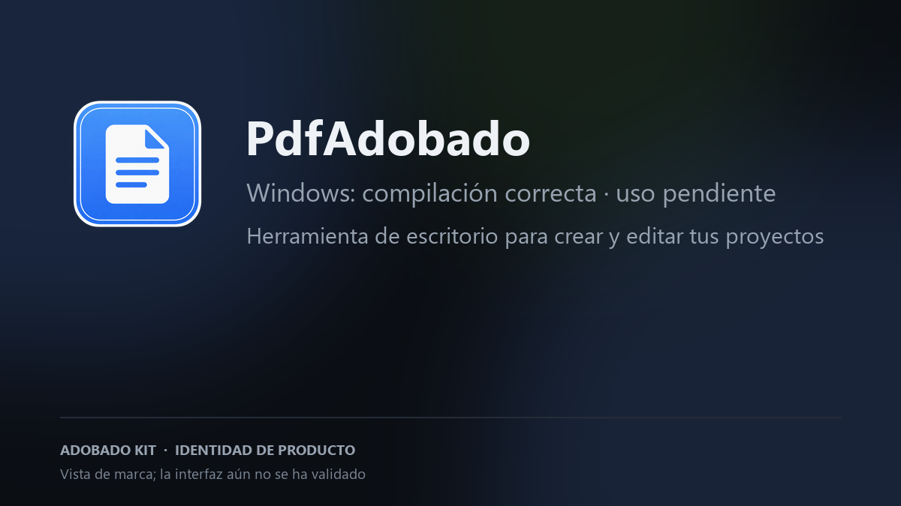

# PdfAdobado

**Lee, edita y organiza documentos PDF.**

> **Pruebas en Windows (20/10/2026):** la compilación es correcta; todavía falta instalar e iniciar la app. El flujo con archivos reales también está pendiente (abrir, editar y exportar). La imagen muestra la marca, no una captura de su interfaz.
>
> Proyecto independiente. No afiliado a ArtCraft ni a Adobe.

Tarjeta de marca; no es una captura de la interfaz.

## Estado

- **Build de Windows:** correcto en GitHub Actions; consulta el [workflow actual](https://github.com/smouj/PdfAdobado/actions/workflows/windows-build.yml).
- **Instalación e inicio:** pendientes de comprobación manual en Windows.
- **Prueba con un archivo:** falta completar el flujo de abrir, editar y exportar.
- **Estado:** alpha; falta validar el inicio y una tarea completa con un archivo real.
- **Descarga pública:** todavía no hay un paquete disponible.
- **Commit de origen:** ec0a965074f376a5bf610435948e4e5184bf3299.

## Build

Requisitos: Rust 1.95 o superior.

    cargo build --release -p pdfcraft

El nombre interno del crate se conserva para no romper el workspace; el nombre de producto visible es PdfAdobado.

## Procedencia y licencias

- Upstream: https://github.com/storytold/pdfcraft
- Commit base: ec0a965074f376a5bf610435948e4e5184bf3299
- Licencia: MIT OR Apache-2.0. Se conservan los archivos de licencia, NOTICE y ATTRIBUTION del upstream.
- Cambios: docs/ADOBADO.md.
- La marca, el wordmark y los logos de ArtCraft no estan cubiertos por la licencia y se retiran de la distribucion.

## Adobado Kit

Este repo forma parte de Adobado Kit: https://github.com/smouj/Adobado_Kit

Hecho por @smouj.
